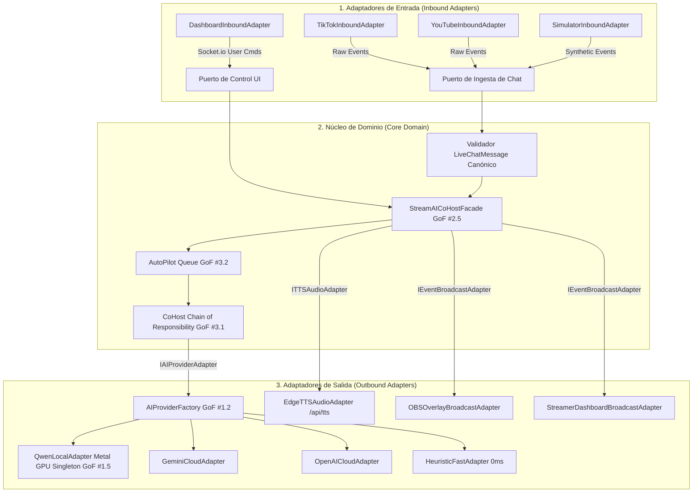

# Especificación Técnica y Arquitectura del Sistema (spec.md)
# Sistema Multi-Plataforma de Chat en Vivo con IA (StreamAI Co-Host)

---

## 1. Visión del Producto y Principios Rectores
**StreamAI Co-Host** es una aplicación de escritorio/web local con diseño nativo **Apple Liquid Glass** (macOS Sequoia HIG) creada para streamers de **TikTok Live**, **YouTube Live** y OBS Studio. Unifica en un único panel reactivo los comentarios entrantes, incorpora un copiloto de Inteligencia Artificial híbrido (Local en Backend con **Qwen 2.5 en Apple Silicon Metal GPU** o en la Nube con Gemini/OpenAI) y sintetiza respuestas orales fluidas mediante streaming MP3 multi-idioma (**Español, Inglés, Ruso y Chino Mandarín**).

---

## 2. Arquitectura Hexagonal (Puertos y Adaptadores)

El sistema se estructura estrictamente en 3 capas desacopladas para garantizar el cumplimiento de contratos e independencia de librerías externas:



---

## 3. Matriz de Patrones de Diseño GoF (Catálogo del Sistema)

Se implementan 9 patrones clásicos de la **Gang of Four (GoF)** sin inventar abstracciones intermedias:

| Patrón GoF | Clasificación | Componente / Clase | Propósito y Contrato |
| :--- | :--- | :--- | :--- |
| **Adapter (#2.1)** | Estructural | `TikTokConnector`, `YouTubeConnector`, `BaseAIProviderAdapter`, `EdgeTTSAdapter` | Transforma payloads y APIs incompatibles de terceros en los contratos únicos y canónicos del dominio. |
| **Facade (#2.5)** | Estructural | `StreamAICoHostFacade` | Expone una interfaz unificada y de alto nivel que encapsula conectores, colas de auto-pilot, IA y TTS ante `server.js`. |
| **Factory Method (#1.2)** | Creacional | `AIProviderFactory` | Método factoría estático `createAdapter(providerId, options)` que instancia el adaptador de IA adecuado según configuración. |
| **Singleton (#1.5)** | Creacional | `QwenLocalEngine` | Mantiene una única instancia del contexto Llama y pesos GGUF en memoria GPU Metal, evitando fugas y recargas. |
| **Strategy (#3.9)** | Comportamiento | `IAIProviderAdapter` / `execute()` | Permite intercambiar en tiempo de ejecución los motores de inferencia (Local Metal, Heurístico, Gemini, OpenAI). |
| **Chain of Responsibility (#3.1)** | Comportamiento | `CoHostChainOfResponsibility` | Cadena secuencial de respuesta: `FastSemanticHandler` (<5ms) -> `QwenLocalGuardian` (Timeout 2s) -> `FallbackHandler`. |
| **Command & Queue (#3.2)** | Comportamiento | `autoPilotQueue`, `aiCommandQueue` | Encapsula cada acción de respuesta en un comando ejecutable en cola FIFO respetando el cooldown y evitando pérdida de chat. |
| **Observer (#3.7)** | Comportamiento | `Socket.io Broadcaster` | Desacopla la generación de eventos (`chat_message`, `ai_reply`, `ai_thinking`) de los observadores (OBS, Dashboard). |
| **Template Method (#3.10)** | Comportamiento | `BaseAIProviderAdapter.execute()` | Define el esqueleto inmutable de generación: `preprocess()` -> `generateResponse()` -> `validateCoherence()` -> `postprocess()`. |

---

## 4. Contratos Formales e Invariantes del Sistema

### Contrato de Mensaje Canónico: `LiveChatMessage`
Todo adaptador de entrada DEBE mapear sus eventos al siguiente objeto inmutable:
```typescript
interface LiveChatMessage {
  readonly id: string;              // Identificador único (ej: msg_1792471234_abc)
  readonly platform: 'tiktok' | 'youtube' | 'simulator';
  readonly author: string;          // Nombre de usuario (@usuario)
  readonly nickname: string;        // Nombre público del espectador
  readonly avatar: string;          // URL de imagen avatar
  readonly message: string;         // Texto limpio del comentario
  readonly isQuestion: boolean;     // True si contiene ? o léxico interrogativo
  readonly isGift: boolean;         // True si es donación/regalo
  readonly giftData: object | null; // Metadatos del regalo si aplica
  readonly timestamp: number;       // Epoch en milisegundos
}
```
* **Invariante 1:** `LiveChatMessage` es inmutable (`Object.freeze`).
* **Invariante 2:** Si `author` no es una cadena válida no vacía, el mensaje es rechazado con `TypeError`.

### Contrato de Proveedor de IA: `IAIProviderAdapter`
Toda estrategia de IA DEBE heredar de `BaseAIProviderAdapter`:
```typescript
interface IAIProviderAdapter {
  readonly providerId: string;
  initialize(): Promise<boolean>;
  execute(author: string, message: string, personalityPrompt: string): Promise<string>;
  generateResponse(author: string, message: string, personalityPrompt: string): Promise<string>;
}
```
* **Invariante 3:** El método `execute()` ejecuta invariablemente el *Template Method*: preprocesa, genera, valida coherencia fonética en español y postprocesa.

---

## 5. Capacidades y Requisitos del Sistema

### RF-1: Gestión de Conexiones en Vivo
- Conexión a **TikTok Live** mediante `@username` con `tiktok-live-connector`.
- Conexión a **YouTube Live** mediante URL o ID de transmisión.
- **Simulador de Chat en Tiempo Real**: generador de mensajes y donaciones sintéticas para calibración sin directo activo.

### RF-2: Interfaz Apple Liquid Glass & NavigationSplitView
- **Estructura macOS**:
  - Barra de ventana con controles semáforo (*traffic lights*: cerrar, minimizar, zoom con símbolos al hover).
  - Barra de herramientas translúcida con buscador estilo Spotlight (`⌘K`).
  - Navegación en triple panel: Sidebar izquierda (canales y métricas), Canvas central (feed de chat con tarjetas flotantes *Liquid Glass*), e Inspector derecho (Apple Intelligence orb y controles).
- **Botones `.buttonStyle(.glass)`**:
  - Micro-bisel de luz especular blanca superior, fondo translúcido y compresión háptica elástica (*spring press*).
- **Iconografía Minimalista**:
  - Iconos vectoriales limpios inspirados en SF Symbols (sin emojis en los controles principales).

### RF-3: Motor de Inteligencia Artificial (Híbrido Backend Local, Heurístico y Cloud)
1. **Motor Neuronal Local en Backend (Qwen 2.5 0.5B Instruct ~468MB - Metal GPU)**:
   - Inferencia nativa C++ en Node.js mediante `node-llama-cpp` aprovechando la aceleración de hardware **Apple Silicon Metal** (`@node-llama-cpp/mac-arm64-metal`).
   - Modelo cuantizado en formato GGUF empaquetado localmente en `/models/qwen/qwen2.5-0.5b-instruct-q4_k_m.gguf`.
   - Tiempo de respuesta en inferencia caliente: **300 a 600 ms**.
   - Soporte multilingüe nativo para español conversacional y coloquial, con penalización anti-repetición (`repeatPenalty: 1.25`).
   - Implementado bajo el **Patrón Singleton (GoF #1.5)** manteniendo el contexto GPU y sesión en memoria.
2. **Motor Inteligente Co-Host Local (Heurístico Reactivo 0ms)**:
   - Procesamiento instantáneo (< 5ms) sin consumo de CPU ni necesidad de API Key.
   - Diseñado bajo el **Patrón Chain of Responsibility (GoF #3.1)** con `FastSemanticHandler` para categorizar intenciones típicas de transmisiones en vivo (saludos con nombre propio, donaciones/regalos, preguntas de partidas, actualizaciones, Discord, música).
   - Validador de coherencia fonética en español bajo el **Patrón Template Method (GoF #3.10)**.
3. **Modo Cloud (Google Gemini 1.5 Flash / OpenAI GPT-4o-mini / Ollama)**:
   - Generación de lenguaje natural profundo con latencia de ~300 a 400 ms.
4. **Cola de Comandos de Auto-Pilot (Command Queue GoF #3.2)**:
   - Cola FIFO secuencial (`autoPilotQueue`) con despachador regulado por tiempo de enfriamiento (cooldown).
   - Interruptor configurable "Responder a Todos" para atender el 100% de los comentarios o alternar a solo preguntas.

### RF-4: Motor Universal de Síntesis de Voz (Streaming MP3 Multi-Idioma)
- Servidor de audio en `/api/tts?text=...&lang=...` que genera flujos de audio en formato estándar `audio/mpeg` (MP3).
- Soporte de pronunciación nativa garantizada en 4 idiomas clave sin depender de los paquetes descargados en el sistema operativo:
  - 🇪🇸 **Español (`es`)**
  - 🇺🇸 / 🇬🇧 **Inglés (`en`)**
  - 🇷🇺 **Ruso (`ru`)**
  - 🇨🇳 **Chino Mandarín (`zh-CN`)**
- Cola de audio secuencial que previene solapamiento de voces.

### RF-5: Overlay Transparente para OBS Studio (`/overlay`)
- Fuente de navegador con fondo 100% transparente.
- Cápsula flotante *Liquid Glass* con el orbe de Apple Intelligence, ondas reactivas al sonido y subtítulos dinámicos de alta visibilidad.

---

## 6. Pila Tecnológica
- **Backend**: Node.js con Express, Socket.io y `node-llama-cpp` (Metal GPU).
- **Frontend**: HTML5, Vanilla CSS avanzado con tokens Apple Liquid Glass, JavaScript modular con diseño GoF (Chain of Responsibility, Strategy, Command Queue, Template Method).
- **Modelos Locales**: Qwen 2.5 0.5B Instruct (GGUF) servido en backend nativo desde `/models/qwen/`.
- **Audio**: Endpoint interno de streaming de audio MP3 nativo (`/api/tts`).
